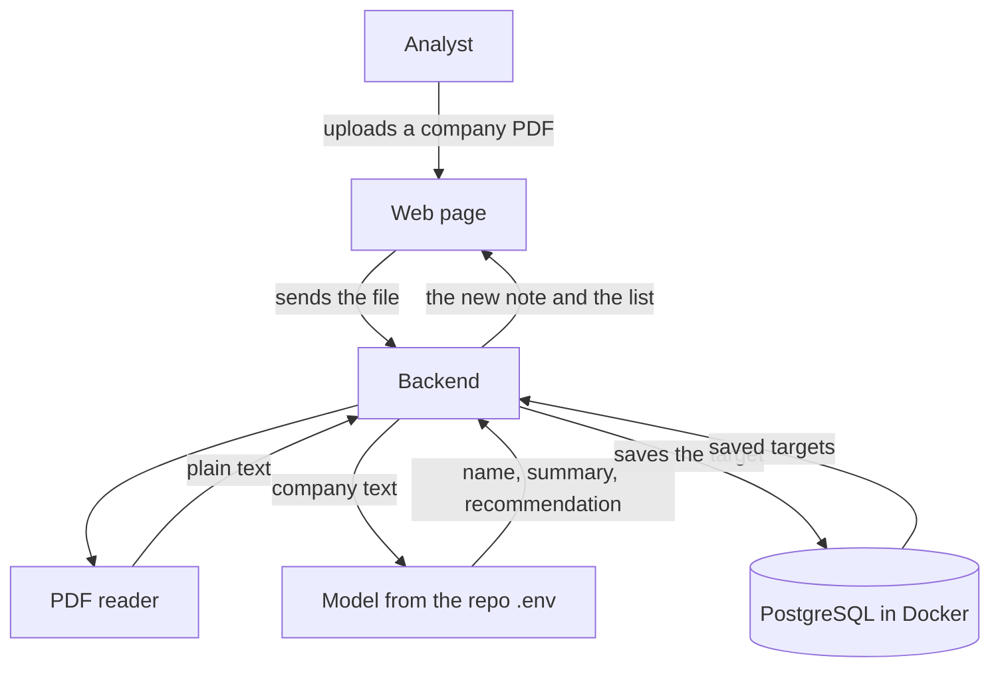

# Acquisition targets

A small app for a first look at a company. An analyst at a private equity firm uploads a PDF — a teaser, a one-pager, a few pages from a CIM. We read it, ask the model for a short view, and save the company as a potential acquisition target.

This pass is one page, one table, and one model call. Postgres runs locally in Docker. The model is whatever the repo `.env` already points at.

The build is split into ordered tasks in [individual_tasks](../individual_tasks). The scripts live in [app/backend](../app/backend) and [app/frontend](../app/frontend). The table is [app/schema.sql](../app/schema.sql). What the app is for is in the [module README](../README.md).

## What the analyst sees

One page.

At the top, a place to upload a PDF and a single button, **Evaluate**. Under that, the companies already saved. The newest one is first. Each company shows its name, industry, a two- or three-sentence summary, a recommendation, and a one-line reason.

The recommendation is one of three words:

- **Look further** — worth a deeper read
- **Pass** — not a fit on what this PDF says
- **Need more info** — the PDF does not say enough to judge

There is no login, no search, and no editing. Upload a PDF, read the note, see it land in the list.

## How the pieces connect

Four pieces, and each one has one job:

| Piece | Job |
| --- | --- |
| Web page | Take the PDF. Show the saved targets. |
| Backend | Receive the file, call the other pieces in order, return the result. |
| Model | Turn the PDF text into a short investment note. |
| PostgreSQL | Remember the targets after the page is closed. |

The page never talks to the database or the model. It only talks to the backend. The backend is the only thing that opens Postgres, and the only thing that calls the model.

## What happens to one PDF

1. The analyst picks a PDF and clicks **Evaluate**.
2. The backend pulls the text out of the PDF.
3. The backend sends that text to the model and asks for a company name, an industry, a short summary, a recommendation, and a reason.
4. The backend writes that note into Postgres, along with the original filename.
5. The page adds the new company to the top of the list.

If the PDF has no readable text, we stop and tell the analyst. We do not invent a company.

## What we store

One table, `targets`. One row is one uploaded PDF.

| Column | What it holds |
| --- | --- |
| `id` | Number we assign |
| `company_name` | Name from the PDF |
| `industry` | Industry from the PDF |
| `summary` | Two or three sentences on the business |
| `recommendation` | `look further`, `pass`, or `need more info` |
| `reason` | One or two sentences on why |
| `source_file` | The PDF's filename |
| `created_at` | When we saved it |

We keep the note, not the PDF file. The filename is enough to know where the note came from.

## What a finished demo looks like

Postgres is running in Docker on the laptop. The page is open in the browser. The analyst uploads a company PDF, waits a few seconds, and sees the company appear in the list with the model's recommendation. Refreshing the page shows the same list, because it is in the database.
